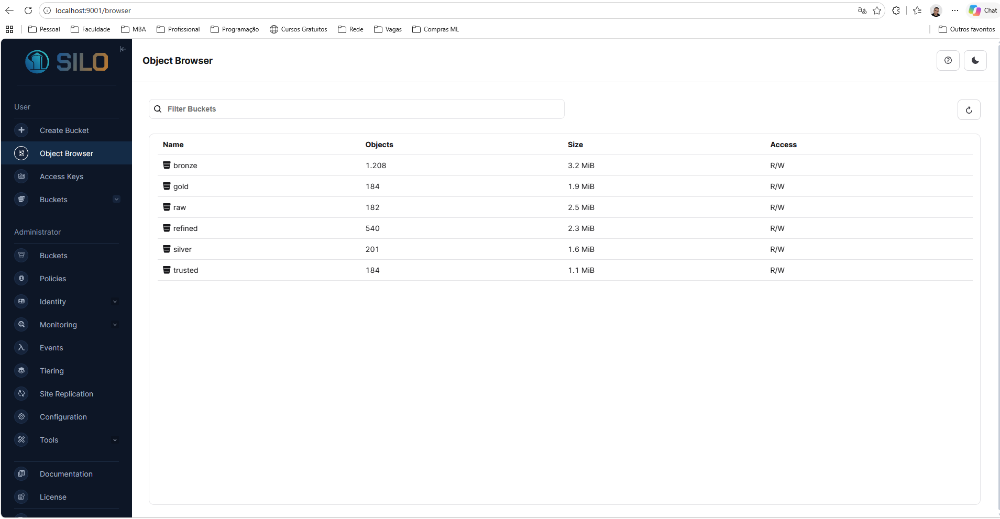
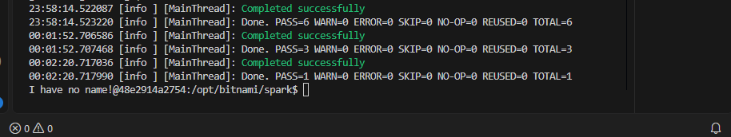
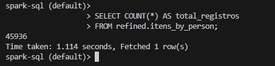
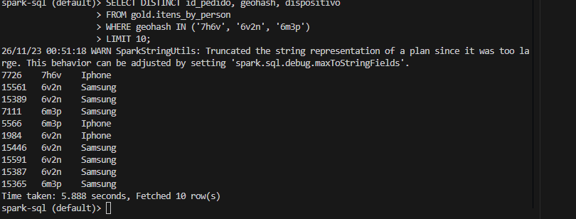
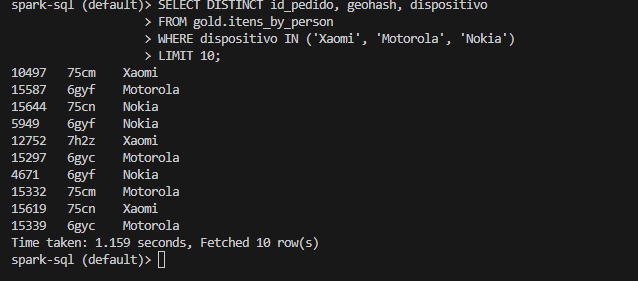

# ✅ Checklist Júnior — Ponta a ponta funcional

**Aluno:** [preencher nome]  
**Disciplina:** Fundamentos de Engenharia de Dados — MBA em Engenharia de Dados  
**Data da execução:** 22/11/2026 (horário de Brasília; alguns logs exibem data/hora UTC)  
**Repositório-base:** [sudoers-ai/jornada_dados](https://github.com/sudoers-ai/jornada_dados)  
**Referência de requisitos:** [desafios/desafios.md](https://github.com/sudoers-ai/jornada_dados/blob/main/desafios/desafios.md)  
**Nível:** Júnior — Ponta a ponta funcional (base)  
**Evidências visuais:** cinco imagens (as duas consultas de exemplos de fraude foram reunidas em uma única figura)

> **Critério deste registro:** os itens são avaliados a partir das saídas de terminal e das capturas efetivamente obtidas. Diferenças entre o roteiro, as adaptações locais e as validações adicionais são identificadas no texto.

---

## 1. Preparação do ambiente

- [x] Ambiente Windows com Python, Git, Docker Desktop e WSL2 disponíveis.
- [x] Repositório `jornada_dados` obtido localmente e utilizado no VS Code/PowerShell.
- [x] Comando de inicialização executado: `docker compose up --build`.
- [x] Verificação de serviços com `docker compose ps`: Airflow, Debezium, Kafka, MinIO, PostgreSQL OLAP, PostgreSQL OLTP e ZooKeeper apareceram como `Up`.
- [x] Spark iniciado posteriormente, após ajuste de compatibilidade do script de entrada.

**Ocorrência técnica — Spark no Windows:** inicialmente, o Spark encerrava na inicialização com a mensagem:

```text
/opt/bitnami/scripts/spark/entrypoint.sh: line 87:
/usr/local/bin/entrypoint.sh: cannot execute: required file not found
```

A verificação do arquivo `delta_lake/entrypoint.sh` identificou que ele continha quebras de linha `CRLF`. Foi feita a conversão para `LF`, preservando os comandos do script, e utilizado `docker compose start spark`. Depois disso, o acesso com `docker exec -it spark bash` e a abertura de `spark-sql` funcionaram.

**Nota:** esta conversão foi uma correção de compatibilidade de ambiente; não foi uma transformação de negócio prevista como tarefa do desafio.

## 2. MinIO — buckets e armazenamento

- [x] Alias do MinIO configurado com o cliente `mc` no ambiente local.
- [x] Buckets `raw`, `trusted` e `refined` criados.
- [x] Política pública aplicada aos três buckets no laboratório local.
- [x] Buckets adicionais `bronze`, `silver` e `gold` criados para a implementação do dbt.
- [x] Conferida a existência de objetos nas seis áreas de armazenamento.

| Bucket | Objetos na captura | Tamanho exibido |
|---|---:|---:|
| raw | 182 | 2,5 MiB |
| trusted | 184 | 1,1 MiB |
| refined | 540 | 2,3 MiB |
| bronze | 1.208 | 3,2 MiB |
| silver | 201 | 1,6 MiB |
| gold | 184 | 1,9 MiB |



***Evidência 01 — MinIO:** comprova a criação dos buckets exigidos (`raw`, `trusted` e `refined`) e a existência de objetos armazenados. A captura também apresenta `bronze`, `silver` e `gold`, utilizados pelo dbt. Os nomes são conceitualmente relacionados às etapas de tratamento, mas representam **buckets físicos distintos** neste laboratório.*

## 3. Geração histórica e streaming

### 3.1. Geração histórica

- [x] Localizado o script `liga_sudoers_historico.py` no repositório anterior do professor, `sudoers-ai/liga_sudoers`, pois não estava presente no clone de `jornada_dados` utilizado.
- [x] Script colocado em `airflow_dags/` e ajustada **somente a configuração de conexão** à instância PostgreSQL do laboratório (porta `5432` e senha local configurada).
- [x] Comando executado: `python .\airflow_dags\liga_sudoers_historico.py 1`.
- [x] Saída final: `Inserção de dados históricos finalizada.` e `Conexão encerrada.`.
- [x] Quantidades de pedidos verificadas antes e depois da execução.

| Momento | Pedidos em PostgreSQL OLTP |
|---|---:|
| Antes do script histórico | 15.668 |
| Depois do script histórico | 16.088 |
| **Novos pedidos** | **420** |

**Adaptação documentada:** foi necessário reutilizar um arquivo de outra atividade e atualizar a configuração de conexão, em vez de executar um arquivo já incluído no repositório atual. Isso deve ser distinguido da orientação geral do desafio de que não seria preciso modificar código.

### 3.2. Geração em streaming

- [x] Executado `python .\airflow_dags\liga_sudoers_streaming.py`.
- [x] Terminal exibiu geração contínua de eventos e registros de anomalias de geohash e dispositivo.
- [x] O script foi encerrado manualmente com `Ctrl+C`; por isso surgiu `KeyboardInterrupt`, que **não foi erro de conexão**.
- [x] Pedidos contados no PostgreSQL OLTP antes e depois do streaming.

| Momento | Pedidos |
|---|---:|
| Antes do streaming | 15.271 |
| Depois do streaming | 15.668 |
| **Novos pedidos** | **397** |

A consulta utilizada para conferir a quantidade foi:

```powershell
docker exec -it postgres_oltp psql -U sudoers -d liga_sudoers -c "SELECT COUNT(*) FROM pedidos;"
```

**Limite da evidência:** as contagens acima foram registradas nas saídas da execução, mas não há, entre as cinco evidências visuais finais, captura específica do antes/depois. A comprovação detalhada está nesta transcrição dos resultados.

## 4. Spark e transformações dbt

- [x] Spark SQL acessado e os schemas `bronze`, `silver`, `gold` e `oltp` preparados.
- [x] Tabelas transacionais registradas no Spark via JDBC: `pessoas`, `categorias`, `produtos`, `pedidos`, `itens_pedidos` e `auditoria_pedidos`.
- [x] dbt instalado e executado em cada uma das três camadas.
- [x] Logs de conclusão sem erros coletados.
- [x] Materializações observadas no ambiente Spark/MinIO, com objetos presentes em Bronze, Silver e Gold.

| Camada dbt | Modelos executados | Resultado |
|---|---|---|
| Bronze | `auditoria_pedidos`, `categorias`, `itens_pedidos`, `pedidos`, `pessoas`, `produtos` | `PASS=6`, `ERROR=0` |
| Silver | `dim_pessoas`, `dim_produtos`, `fato_pedidos` | `PASS=3`, `ERROR=0` |
| Gold | `itens_by_person` | `PASS=1`, `ERROR=0` |

O `dbt.log` apresentou `Completed successfully` para as três execuções.



***Evidência 02 — dbt:** mostra três execuções concluídas com sucesso: seis modelos Bronze, três Silver e um Gold; nenhum erro registrado nos resumos.*

**Ressalva sobre o DW:** a evidência confirma as materializações executadas pelo dbt no Spark/MinIO. Não foi registrada uma validação independente de novas materializações na instância **PostgreSQL OLAP** após o dbt; portanto, não se deve afirmar que esse destino específico foi validado.

## 5. Data Lake — Raw, Trusted e Refined

- [x] CSV de `dim_pessoas` extraído de PostgreSQL OLAP e copiado para `raw/dim_pessoas/dim_pessoas.csv` no MinIO.
- [x] Tabelas federadas `olap.dim_pessoas` e `olap.dim_produtos` criadas no Spark SQL por JDBC.
- [x] Schema `raw` e tabela externa `raw.dim_pessoas` criados e lidos no Spark.
- [x] Processamento posterior realizado em `raw`, `trusted` e `refined`, seguindo as instruções do roteiro Delta Lake.
- [x] Tabela `refined.itens_by_person` consultada, incluindo sua estrutura e a contagem de registros.

**Resultado da consulta Spark:**

```sql
SELECT COUNT(*) AS total_registros
FROM refined.itens_by_person;
```

```text
45936
Time taken: 1.114 seconds, Fetched 1 row(s)
```



***Evidência 03 — Spark / Refined:** mostra 45.936 registros na tabela `refined.itens_by_person`. A estrutura também foi consultada com `DESCRIBE`; esse comando não aparece nesta captura específica.*

**Observação de qualidade:** a primeira leitura de `raw.dim_pessoas` retornou 21 linhas, incluindo uma linha de cabeçalho do CSV e 20 pessoas. Essa ocorrência merece registro e não deve ser confundida com 21 clientes válidos. A etapa Refined foi materializada e consultada depois.

## 6. Verificação das regras de antifraude

**Critérios utilizados pelo simulador / checklist de referência:**

- **Geohash fora do conjunto esperado:** valores fora de `6gyf`, `6gyc`, `75cm`, `75cn`, `7h2y`, `7h2z`, `7h2w` são tratados como anômalos na consulta de validação.
- **Dispositivos fora dos modelos esperados:** valores diferentes de `Samsung` e `Iphone` são tratados como anômalos na consulta de validação.

Esses critérios servem à simulação da atividade; **não são regras gerais de detecção de fraude do mundo real**.

### 6.1. Exemplo — geohash anômalo

Pedido `7726`, geohash `7h6v`, dispositivo `Iphone`, apresentado no resultado da consulta em Gold. Outros valores encontrados foram `6v2n` e `6m3p`.

### 6.2. Exemplo — dispositivo anômalo

Pedido `4671`, geohash `6gyf`, dispositivo `Nokia`, apresentado no resultado da consulta em Gold. Também foram observados `Motorola` e `Xaomi`.



* **Evidência 04 — Exemplos de antifraude:** as duas capturas originais foram reunidas em uma figura, sem alterar os comandos nem os resultados. Na parte superior aparecem geohashes fora do conjunto válido do exercício; na parte inferior, dispositivos fora dos modelos esperados. Esta segunda consulta identifica **dispositivo anômalo**, mas não compara dois eventos de um mesmo cliente ao longo do tempo.

### 6.3. Proporção de pedidos sinalizados

Consulta complementar de validação, adaptada do checklist de referência consultado:

```sql
SELECT
    COUNT(DISTINCT ID_PEDIDO) AS PEDIDOS,
    COUNT(DISTINCT CASE
        WHEN GEOHASH NOT IN ('6gyf','6gyc','75cm','75cn','7h2y','7h2z','7h2w')
          OR DISPOSITIVO NOT IN ('Samsung','Iphone')
        THEN ID_PEDIDO
    END) AS PEDIDOS_FRAUDE
FROM gold.itens_by_person;
```

| Indicador | Resultado |
|---|---:|
| Pedidos distintos analisados na Gold | 15.667 |
| Pedidos sinalizados por ao menos uma condição | 178 |
| **Taxa de pedidos suspeitos** | **1,14%** |

Cálculo: `178 / 15667 × 100 ≈ 1,14%`.



* **Evidência 05 — Proporção de pedidos suspeitos:** consulta com `COUNT(DISTINCT ...)` identificando 178 pedidos que atendem a pelo menos uma regra simulada, entre 15.667 pedidos distintos analisados (1,14%).

**Atenção ao período de referência:** esses indicadores foram coletados **antes da última execução do gerador histórico**, que elevou a tabela `pedidos` do PostgreSQL OLTP para 16.088 registros. Não foi feita nova execução de dbt/Gold após essa carga; por isso **não se devem equiparar os 15.667 pedidos distintos da Gold aos 16.088 pedidos atuais do OLTP**.

## 7. Orquestração e recursos opcionais

- [ ] **Airflow/DAG de ingestão → dbt → checagem:** não foi realizado como entrega deste nível. Houve uma captura anterior de DAG dbt da aula, mas ela não foi incluída como evidência do Júnior.
- [ ] **CDC Debezium → Kafka:** não validado; parte do escopo Pleno.
- [ ] **Validação via AWS CLI:** não realizada; não necessária para este conjunto de evidências.

## 8. Resumo final das tarefas oficiais

| # | Requisito do Nível Júnior | Situação | Justificativa |
|---|---|---|---|
| 1 | Subir stack com `docker compose up --build` | ✅ Concluído | Serviços iniciados; Spark corrigido e iniciado depois |
| 2 | Criar buckets `raw/trusted/refined` públicos | ✅ Concluído | Buckets criados; objetos presentes no MinIO |
| 3 | Rodar `liga_sudoers_historico.py` e confirmar novas linhas | ✅ Concluído com adaptação | Script de repositório anterior; **+420 pedidos** no OLTP |
| 4 | Rodar `liga_sudoers_streaming.py` e confirmar chegada | ✅ Concluído | **+397 pedidos** no OLTP |
| 5 | Executar dbt e verificar materializações no DW | ⚠️ Parcialmente comprovado | dbt Bronze/Silver/Gold OK, materializações confirmadas no Spark/MinIO; sem consulta independente ao PostgreSQL OLAP após dbt |
| 6 | Ler dados no Spark e confirmar schema + count | ✅ Concluído | `DESCRIBE` consultado; **45.936** registros em Refined |
| 7 | Validar regras de fraude (geohash e troca de device) | ⚠️ Parcialmente comprovado | Geohashes e devices anômalos encontrados; comparação histórica por cliente não realizada |

## 9. Conclusão e limitações

Foi possível executar o ambiente Docker do projeto, gerar novos dados por streaming e por carga histórica, transformar dados com dbt, preencher buckets nas camadas Raw/Trusted/Refined e Bronze/Silver/Gold, e consultar a camada analítica no Spark. Os resultados medidos foram **420 pedidos gerados pelo histórico**, **397 pedidos acrescidos durante o streaming**, **45.936 linhas na Refined** e **178 pedidos suspeitos em 15.667 pedidos distintos da Gold (1,14%)**, em instantes de apuração diferentes.

**Limitações documentadas:** (1) o script histórico foi recuperado de outra atividade do professor e teve a conexão adaptada; (2) a checagem da materialização no PostgreSQL OLAP, especificamente, não foi feita após dbt; (3) a anomalia por dispositivo foi identificada, mas não comprovada como uma transição temporal do mesmo cliente; e (4) a carga histórica final não foi reprocessada na Gold. Essas observações evitam atribuir ao pipeline resultados que não foram medidos.

---

**Referências**  
- [Desafio Júnior oficial](https://github.com/sudoers-ai/jornada_dados/blob/main/desafios/desafios.md)  
- [Quickstart](https://github.com/sudoers-ai/jornada_dados/blob/main/quickstart/README.md)  
- [Delta Lake](https://github.com/sudoers-ai/jornada_dados/blob/main/delta_lake/README.md)  
- [dbt](https://github.com/sudoers-ai/jornada_dados/blob/main/dbt_project/README.md)  
- [Gerador histórico da atividade anterior](https://github.com/sudoers-ai/liga_sudoers/blob/main/data_simulator/liga_sudoers_historico.py)
